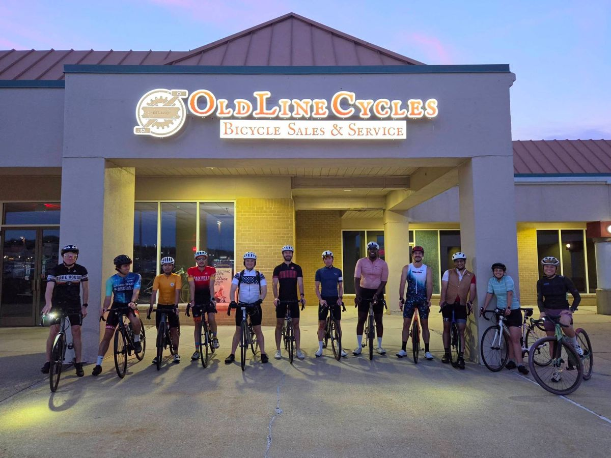
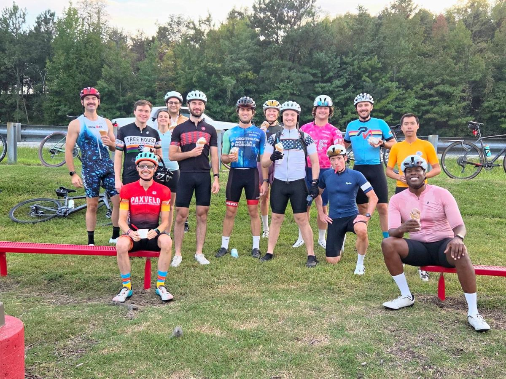
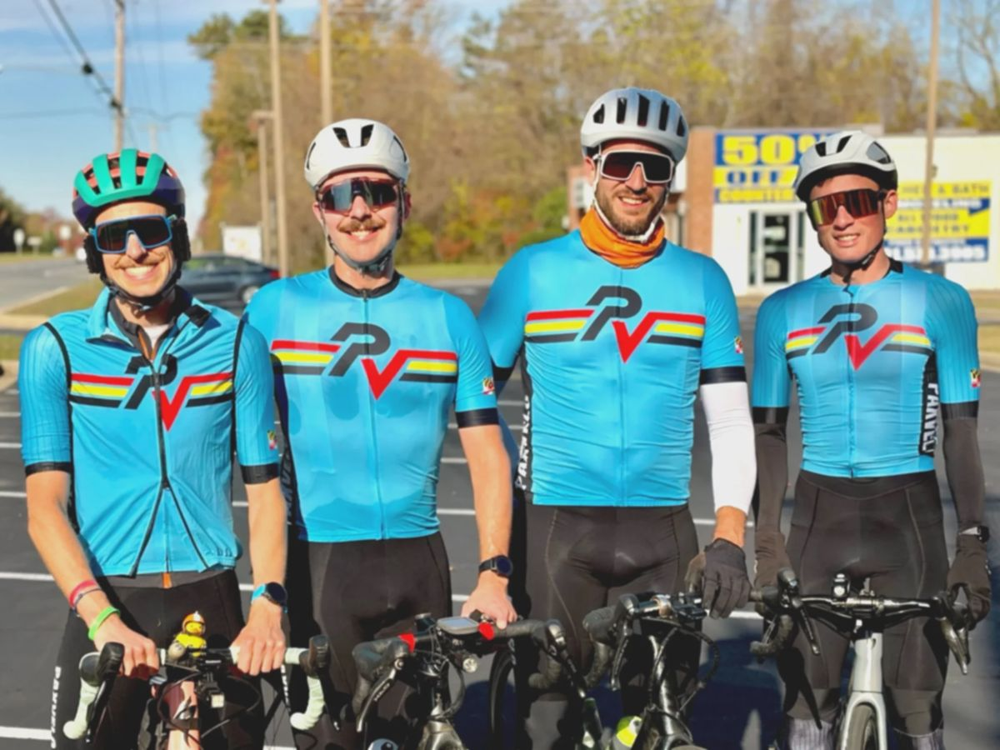
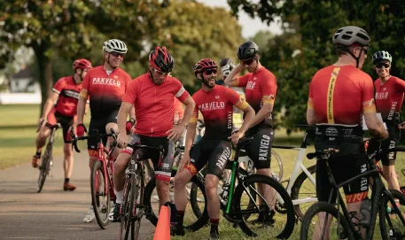
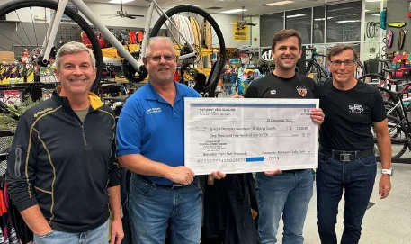

# Welcome to PaxVelo

Southern Maryland’s Premier Cycling Club

[See upcoming rides on Strava]({strava})

{social-links}

## All Riders Welcome

PaxVelo is a 501(c)(3) nonprofit cycling club. We’re here for great roads, good company, and the community we ride through.

  

### Ride With Us

From race-pace training to easy weekend spins, there’s a PaxVelo ride for every rider. We roll out on Southern Maryland’s beautiful roads all season long, and every ride is posted on Strava.

[About our rides](rides.md) [Find a ride on Strava]({strava})

### Giving Back

As a nonprofit, PaxVelo exists to enrich the community we ride in. Each year we host the St. Mary’s Century, bringing riders from across the region to Southern Maryland, and proceeds support local causes chosen by our members.

<!-- This link only appears once DONATE_URL is set in the server settings. -->
[Support the club]({donate}) 

## On Instagram

Club rides, race days, and the roads of Southern Maryland, as they happen.

{instagram}

## Become a Member

Membership runs January through December and supports club rides, events, and our work in the community.

{membership-plans}

Want to ride in club colors? [Shop PaxVelo kit]({kit}) in our team store.
