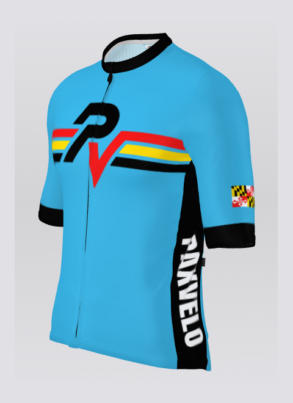
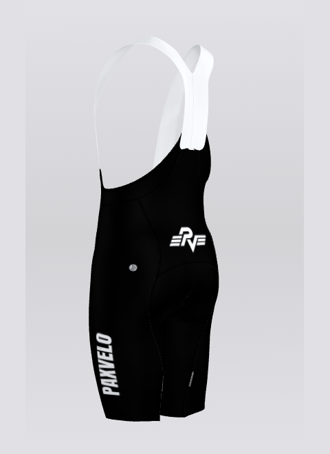

# Club Kit

Ride in club colors. Our kit is custom-made by Jakroo, and you order it from the PaxVelo team store on their website.

 

## Two Ways to Order

### Any Time

The team store is always open. Order whenever you like, at the team price. Each piece is made to order, so it takes about three weeks to reach you.

### The Yearly Bulk Order

Once a year, the club puts in one big order together, which brings the price down. Watch the newsletter and Discord for when it opens.

<!-- When this year's bulk order is set, add the dates above, like: This year's order is open March 1–21. -->

## Finding Your Size

The team store has a free size recommendation: answer a few questions and it suggests a size for each piece. Still not sure? Ask on [Discord](https://discord.gg/8TtR4pu4C2). Plenty of members have been through it.

[Open the team store]({kit})

The store is on Jakroo's website and opens in a new tab.
